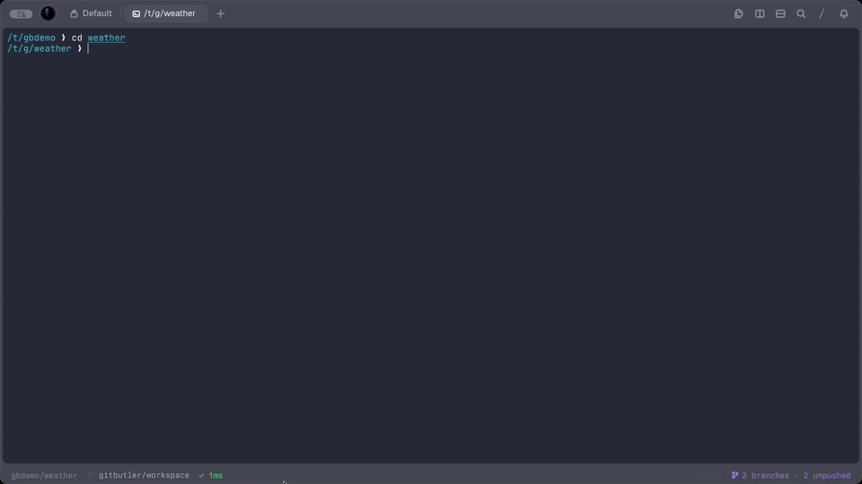
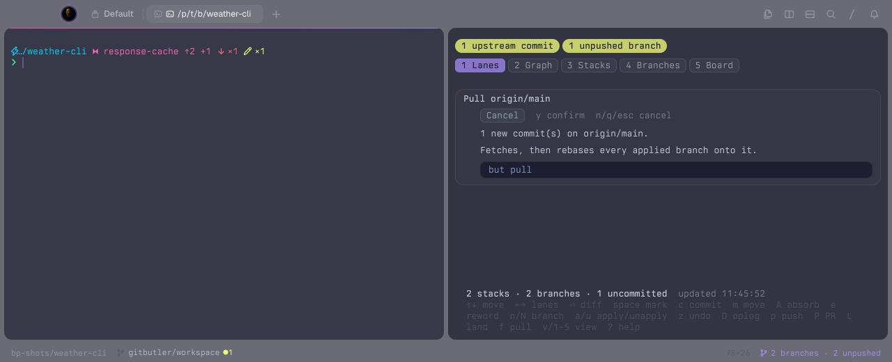

```
 ██████╗ ██╗████████╗██████╗ ██╗   ██╗████████╗██╗     ███████╗██████╗
██╔════╝ ██║╚══██╔══╝██╔══██╗██║   ██║╚══██╔══╝██║     ██╔════╝██╔══██╗
██║  ███╗██║   ██║   ██████╔╝██║   ██║   ██║   ██║     █████╗  ██████╔╝
██║   ██║██║   ██║   ██╔══██╗██║   ██║   ██║   ██║     ██╔══╝  ██╔══██╗
╚██████╔╝██║   ██║   ██████╔╝╚██████╔╝   ██║   ███████╗███████╗██║  ██║
 ╚═════╝ ╚═╝   ╚═╝   ╚═════╝  ╚═════╝    ╚═╝   ╚══════╝╚══════╝╚═╝  ╚═╝
```

# GitButler for Tern

GitButler for Tern is a [Tern](https://docs.stencil.so/tern/index.html) plugin that brings [GitButler](https://gitbutler.com) workspaces into your terminal. It adds a status bar segment, a workspace panel with one lane per branch stack, view tabs, sync status chips and diffs in place, native rendering for `but status`, `but diff`, `but show` and `but oplog`, and palette commands for setting up a folder, pulling upstream, and opening `but tui` or the GitButler app. Every change it makes runs through the `but` CLI, so it never writes with raw git.



The full 74-second demo: commit from the panel, flip through the five views, commit on the board, pull, undo, and open `but tui` ([MP4](docs/images/demo.mp4)).

https://github.com/user-attachments/assets/89888417-9b98-4774-9684-eb0e0a3b9935


*Screenshots on this page come from a small demo repository with two stacks (`response-cache` and `units-flag`), so they show more than the tutorial's single file.*

## Tutorial: your first commit with GitButler for Tern

In this tutorial, we will install the plugin, set up a practice folder, and use the workspace block to look at a change, commit it to a branch, and undo it. It takes about ten minutes. We work in a throwaway folder in `/tmp`, so nothing we do touches your real projects.

### Before you start

You need:

- macOS with [Tern](https://docs.stencil.so/tern/index.html) (tested with 0.8.3)
- The GitButler CLI, `but` (tested with 0.22.3). Run `but --version` to check.
- Tern's status bar turned on. Add `"status_bar": true` to `~/Library/Application Support/Tern/settings.json`, then quit and reopen Tern. The setting doesn't apply to a running Tern.

### Step 1: Install the plugin

First, we clone the plugin and link its `plugin/` folder into Tern:

```sh
git clone https://github.com/edheltzel/gitbutler-for-tern.git
cd gitbutler-for-tern
tern plugin link plugin
tern plugin list
```

You should see `gitbutler` with the version declared in [plugin/plugin.toml](plugin/plugin.toml), the name `GitButler`, and `ready`.

`ready` means Tern loaded both halves of the plugin. Link the `plugin/` folder, not the repository root.

### Step 2: Set up a practice folder

Open a new Tern tab, so the shell starts after the plugin has loaded, and make an empty folder:

```sh
mkdir -p /tmp/gb-tutorial && cd /tmp/gb-tutorial
```

Now open the command palette and run **GitButler: Set up this folder**.

You should see a **GitButler is set up** toast, and the status bar shows `0 branches · 0 unpushed` on the right. The command runs `but setup --init`: it creates a git repository with an empty first commit (only when the folder has none), registers it with GitButler, and switches it to the `gitbutler/workspace` branch. In a folder that is already a git repository, the same command skips the first part.


The segment appears only in folders GitButler manages. Run `cd /tmp` and it disappears; run `cd /tmp/gb-tutorial` and it comes back.

### Step 3: Open the workspace block

Let's make a change for the plugin to show. In the shell, run:

```sh
echo hello > b.txt
```

Now press **⌥⇧⌘G**, or click the status segment.

You should see the **GitButler** workspace block open beside your shell. Its top bar has a tab for each view and colored chips with the sync state in GitButler's own words: **Up to date** or **N upstream commits**, and **Nothing to push** or **N unpushed branches**. Its first lane, **Uncommitted 1**, lists `b.txt` with an `A` (added) marker and `unassigned` on the right. The line at the bottom shows `0 stacks · 0 branches · 1 uncommitted` and when the block last refreshed. The block refreshes itself every 5 seconds, and **r** refreshes it right away.

### Step 4: Read the diff

Use **↑** and **↓** to select `b.txt`, then press **⏎**.

You should see the diff open inside the workspace block, in place of the lanes, showing the new line `+hello`. Press **Esc**, **Backspace** or **q**, or click **← Back**, to return to the lanes. A view tab returns directly to that view. Then press **⏎** on another row to see its diff.

While the diff is open, workspace action keys such as **c** and **p** are inactive. Return to the list first, or use a palette action, which returns to the list and acts on its selection. **r** refreshes the workspace before reloading the patch; if a mutation is running, it waits for that mutation's status refresh. File, commit and named-branch diffs follow their target across CLI id changes and close when a status refresh no longer finds it. Their patches reload when a refresh detects workspace changes, even when the commit subject stays the same.

Unnamed branches open a diff for the current snapshot; it closes when a refresh detects a workspace change or a manual **r** refresh succeeds. Paths containing `:` and commits or committed files without a change id show a warning instead.


### Step 5: Commit to a new branch

Click back into the workspace block if you closed the diff. Select `b.txt`, press **space** to mark it, then press **c**.

A sheet opens at the top of the block. Choose **New branch…** and press **⏎**, type `first-branch` and press **⏎**, then type the commit message `add b.txt` and press **⏎**.


You should see a new lane titled `first-branch`, with the branch marked **Unpushed branch**, one commit `add b.txt`, and the file under it. The **Uncommitted** lane now reads `No uncommitted changes.`, the chip at the top reads **1 unpushed branch**, and the bottom line says **Committed 1 file to first-branch**.

To confirm from the shell, run:

```sh
but status
```

The plugin renders the output as a native block (a "lens") instead of plain text: chips with the stack, branch and uncommitted counts, then a tree with `first-branch` and its commit.


### Step 6: Undo it

Press **z** in the workspace block.

A sheet titled **Undo the last operation** names the operation (`CreateCommit`) and shows the exact command, `but undo`. Undo rewrites history, so the sheet accepts only **y**. Press **y**.


You should see the whole `first-branch` lane disappear, `b.txt` return to the **Uncommitted** lane, and **Undid CreateCommit** at the bottom. GitButler records every operation, so **O** (restore from the oplog) can step back further.

### What you've learned

In this tutorial, you:

- Installed the plugin and checked that it loaded
- Turned a folder into a GitButler workspace from the palette
- Found the status segment that appears in GitButler-managed folders
- Opened the workspace block and read a diff
- Committed a file to a new branch without touching raw git
- Saw `but status` render as a native block
- Undid an operation through a confirmation sheet

### Next steps

- Press **?** in the workspace block for every key: **m** moves a file or commit to another branch, **A** absorbs changes into the commits they belong to, **e** rewords a commit or renames a branch, **n** / **N** make a parallel or stacked branch, **a** / **u** apply or unapply branches, and **p** / **P** push a branch or open a pull request.
- Click a tab at the top of the workspace block, or press **1**-**5** (**v** cycles), to switch views: **lanes** (the default: an Uncommitted card plus a card per stack with its branches, commits and files on a colored line), **graph** (a commit graph with a lane per stack), **stacks** (one column per stack, like the GitButler app), **branches** (a branch list with the selected branch's commits, or the selected lane's uncommitted files) and **board** (below). Click a row to select it or double-click to show its diff in the panel; **Esc** goes back. In **lanes** and **graph**, details sit beside the list, or under it in a narrow pane. These previews show the selected file's change and assignment, a commit's ids, message and files, or a branch's base and newest commits as space allows; short panes omit fields and shorten lists. Enlarge the pane to see more details, or press **⏎** for the full diff in the panel. Every key works the same in each view, and the block remembers your choice. Long labels clip to fit; `↑ N more` / `↓ N more` mark hidden rows you can reach with the arrow keys. In the branches view, the commit-count badge reports commits not shown, and `+N files` beside a commit counts its hidden files.
- The chips beside the tabs say where you stand, in GitButler's words: **Up to date** (green) or **N upstream commits** (amber), **Nothing to push** or **N unpushed branches**, plus **N diverged** (red: a pushed branch whose history changed, so its next push is a force push), **Conflicted**, and what is running while a command works. Click the upstream chip to pull. Each branch carries the GitButler desktop app's label: **Unpushed branch**, **Some unpushed**, **Nothing to push**, **Diverged** or **Integrated**.
- The **board** view works like the GitButler desktop app, with the mouse. The workspace block can't receive drags, so here you click what you want to move, then click where it goes (for real dragging, see the drag-and-drop board below):
  - Click a file, or tick the boxes of several, and the branches show **Commit here**, each commit shows **Amend**, and the New branch column offers **Commit to a new branch**.
  - Click a commit and other commits show **Squash** and **Above** (reorder), branches show **Move here**, and the Uncommitted column shows **Uncommit**. A committed file can **Move in** to another commit.
  - Use the toolbar's **←** / **→** buttons to browse columns and click **↑ N more** / **↓ N more** to browse cards. Short columns put **↑** / **↓** in the header when a marker cannot fit. When no cards fit, columns show only their headers; enlarge the pane or clear a notice with **r** to make room. Browsing keeps your selected change and checked files held while you reach another destination, including Uncommitted and New branch.
  - Right-click any card for its actions (commit, reword, push, PR, uncommit, discard, …). The toolbar has Commit, Absorb, New branch, Pull, Undo, Redo, Oplog and Discard.
  - Actions use the same prompts and confirmation guards as the keyboard and palette; confirmation sheets show the exact `but` command. Anything that rewrites pushed history or deletes work asks for **y**. See the action reference in [DESIGN.md](DESIGN.md) for each operation's confirmation rules.

  
- Run **GitButler: Open drag-and-drop board** to drag cards the way the GitButler desktop app does. It opens Tern's own board beside the workspace block: an **Uncommitted** lane with your changed files, a lane per branch with its commits (newest first), and **New branch**. Drag a file onto a branch to commit it there, or onto New branch to commit it to a new branch. Drag a commit onto another branch or between two commits to move it there, onto Uncommitted to uncommit it, or onto New branch to move it to a new branch. Each drag runs the same prompts and confirmations as the workspace block (the commit message or `y` sheet opens in the block); cancel one, or let `but` refuse it, and the card goes back. The board is a generated file in the plugin's data folder, rewritten whenever the workspace changes, so ticking, adding or editing cards has no effect.
- **f** pulls, and so does a click on the upstream chip: it checks the target branch (for example `origin/main`), says `Already up to date` when there is nothing new, and otherwise shows the new commit count and predicted branch or uncommitted-file conflicts. Press **y** to check again; a changed plan requires another confirmation before pulling. Pulling rebases every applied branch onto the target. The result reports actual branch and unresolved file conflicts, or warns when the result or worktree status could not be verified; **z** undoes the pull. If a sheet is open, the result waits for it to close. When the target is ahead, the chip reads **N upstream commits**; after a pull it turns green and reads **Up to date**.

  
- **L** lands a branch with `but land --yes`, which updates the target branch directly without a pull request. Skip it in repositories where work must land through a PR.
- Press **⌥⇧⌘T**, or run **GitButler: Open TUI** from the palette, to open GitButler's terminal UI in a floating pane over your shell; **q** closes it. Running it again focuses that workspace's live TUI instead of opening another. Run **GitButler: Open GUI** to open the desktop app on the same workspace.

  
- Run **GitButler: Set up this folder** in an existing git repository to start using GitButler there. It refuses your home folder and `/`.
- When you're done, delete the practice folder: `rm -rf /tmp/gb-tutorial`.

## Keys

Two commands have a default chord: ⌥⇧⌘G opens the workspace block and ⌥⇧⌘T opens `but tui`. Every command has a palette entry named `GitButler: …` and an id you can bind yourself (below). For workspace actions, a bound key opens or focuses the block and runs the action on its selection, with the same confirmations as its controls.

| Default | Id | Action | Block key |
|---|---|---|---|
| ⌥⇧⌘G | `open` | Open the workspace block | |
| ⌥⇧⌘T | `tui` | Open `but tui` in a floating pane | |
| | `board` | Open the drag-and-drop board | |
| | `gui` | Open the GitButler app | |
| | `commit` | Commit to a branch | c |
| | `move` | Move the selection to a branch | m |
| | `absorb` | Absorb uncommitted changes | A |
| | `reword` | Reword a commit or rename a branch | e |
| | `branch` | New parallel branch | n |
| | `stack` | New stacked branch | N |
| | `apply` | Apply a branch | a |
| | `unapply` | Unapply the selected stack | u |
| | `undo` | Undo the last operation | z |
| | `redo` | Redo the last undone operation | |
| | `oplog` | Restore from the oplog | O |
| | `push` | Push the selected branch | p |
| | `pr` | Open a pull request | P |
| | `land` | Land the selected branch | L |
| | `pull` | Pull upstream into applied branches | f |
| | `uncommit` | Uncommit the selected commit or file | |
| | `discard` | Discard the selection | |
| | `view` | Switch the workspace view | v |
| | `help` | Show the workspace keys | ? |
| | `setup` | Set up this folder | |

### Your own keys

Every command is a Tern action named `plugin.gitbutler.<id>`. Bind the ones you want in Tern's `settings.json`; your entries win over the defaults above, and `"unbind"` removes one:

```json
{
	"keybinds": {
		"cmd+alt+shift+c": "plugin.gitbutler.commit",
		"cmd+alt+shift+p": "plugin.gitbutler.push",
		"cmd+alt+shift+t": "unbind"
	}
}
```

Tern's Keyboard settings list only actions that have a key, by id with the description "A plugin's action." (a plugin can't set that label), so an unbound command shows there once you bind it. Don't use ⌥⇧⌘B or ⌥⇧⌘S: Tern's own keymap holds them. The single-letter keys inside the block are fixed.

### Getting back from a sheet

Most workspace keys open a sheet at the top of the block. Every sheet has a **Cancel** button (**Close** on help), and Escape closes it. `q` also closes every sheet except a text prompt, where it types a q. A pasted "q", Shift+Q or Ctrl+Q never closes a sheet.

| Key | Sheet | Closes with |
|---|---|---|
| `?` | Help | `q`, Escape, Close |
| `O` | Restore from the oplog (picker) | `q`, Escape, Cancel |
| `c`, `m` | Choose a branch (picker) | `q`, Escape, Cancel |
| `a` | Apply a branch (picker; a notice when nothing is unapplied) | `q`, Escape, Cancel |
| `z` | Undo (confirm) | `q`, `n`, Escape, Cancel |
| `A` | Absorb (confirm) | `q`, `n`, Escape, Cancel |
| `u`, `p`, `P`, `L` | Unapply / push / pull request / land (confirm) | `q`, `n`, Escape, Cancel |
| `f` | Pull (confirm; a notice when already up to date) | `q`, `n`, Escape, Cancel |
| `e`, `n`, `N`, and the commit message after `c` | Text prompt | Escape, Cancel (`q` is text) |

## How it works

`DESIGN.md` covers the surfaces, the `but --json` fields the plugin relies on, and how each action maps to a `but` command. Contributor and agent rules live in `AGENTS.md`.
