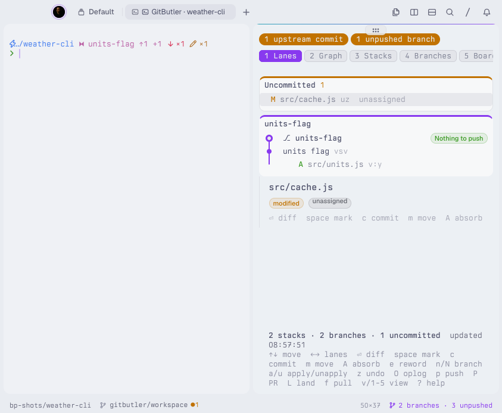
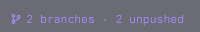
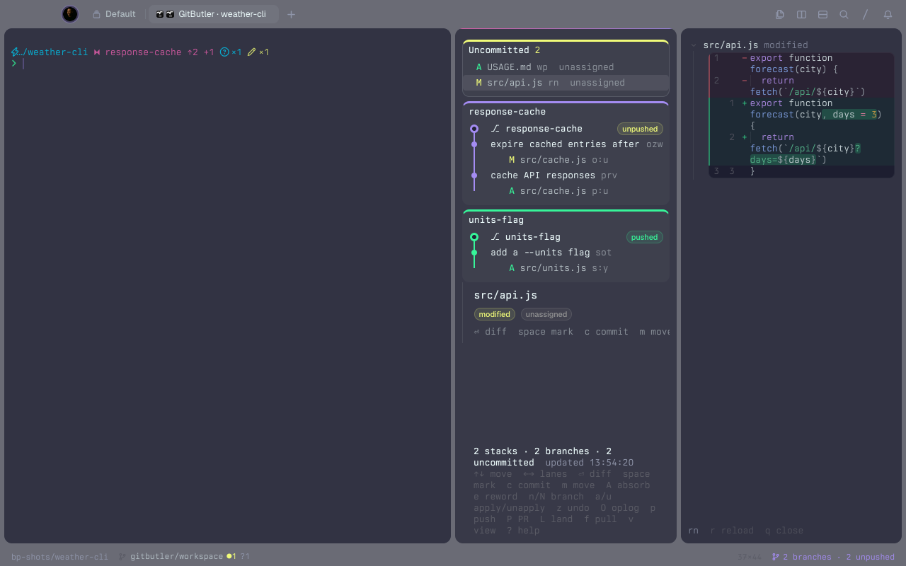
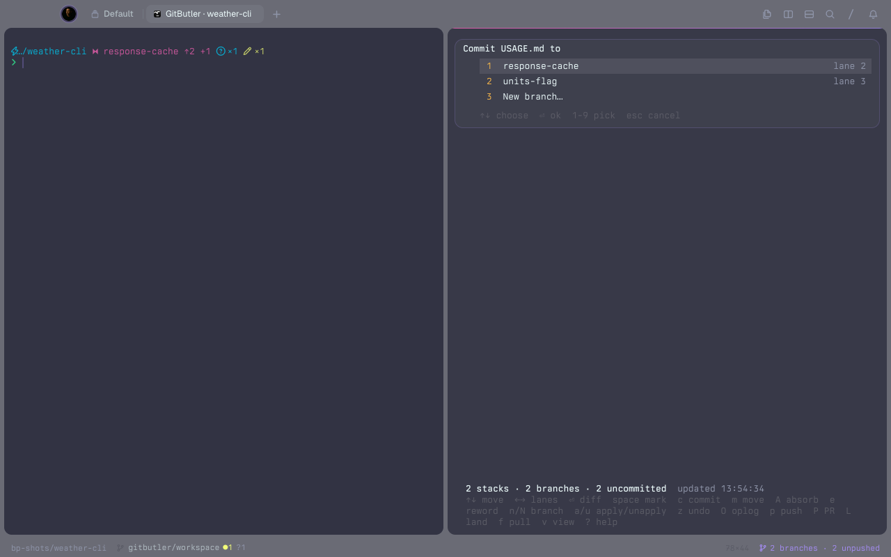
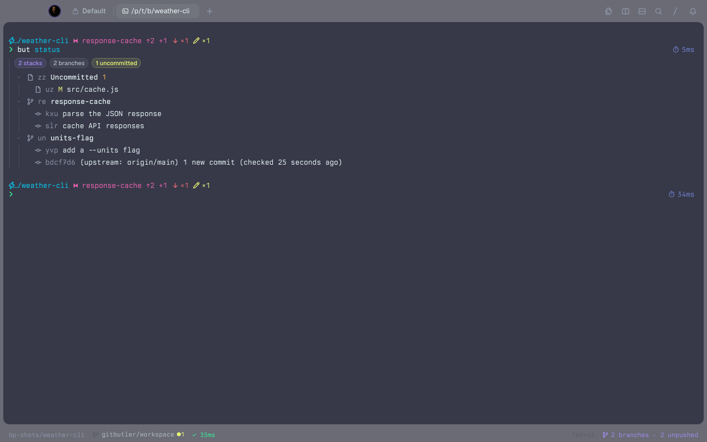
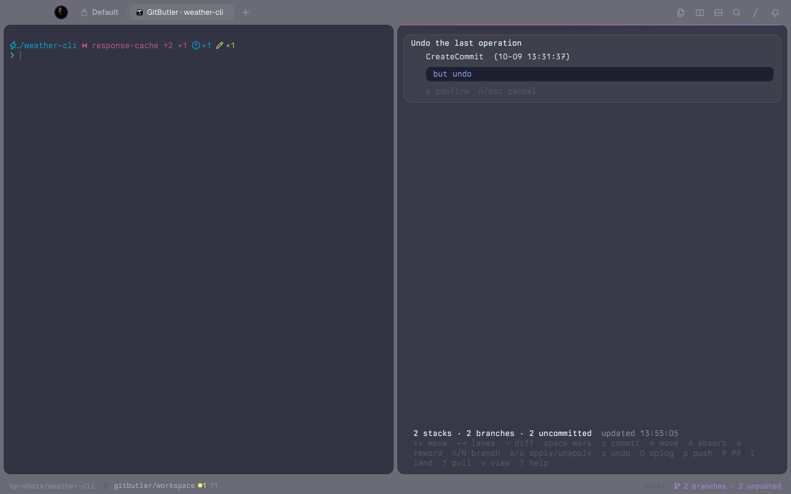
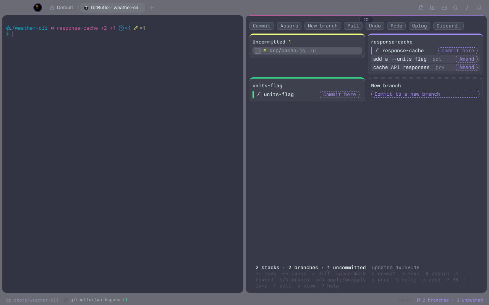
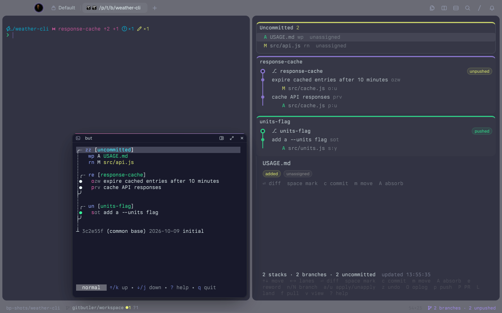

```
 ██████╗ ██╗████████╗██████╗ ██╗   ██╗████████╗██╗     ███████╗██████╗
██╔════╝ ██║╚══██╔══╝██╔══██╗██║   ██║╚══██╔══╝██║     ██╔════╝██╔══██╗
██║  ███╗██║   ██║   ██████╔╝██║   ██║   ██║   ██║     █████╗  ██████╔╝
██║   ██║██║   ██║   ██╔══██╗██║   ██║   ██║   ██║     ██╔══╝  ██╔══██╗
╚██████╔╝██║   ██║   ██████╔╝╚██████╔╝   ██║   ███████╗███████╗██║  ██║
 ╚═════╝ ╚═╝   ╚═╝   ╚═════╝  ╚═════╝    ╚═╝   ╚══════╝╚══════╝╚═╝  ╚═╝
```

# GitButler for Tern

> [!NOTE]
> GitButler workspaces in Tern panes. Source: [github.com/edheltzel/gitbutler-for-tern](https://github.com/edheltzel/gitbutler-for-tern)

GitButler for Tern is a [Tern](https://docs.stencil.so/tern/index.html) plugin that brings [GitButler](https://gitbutler.com) workspaces into your terminal. It adds a status bar segment, a workspace block with one lane per branch stack, a diff block, native rendering for `but status`, `but diff`, `but show` and `but oplog`, and palette commands for setting up a folder, pulling upstream, and opening `but tui` or the GitButler app. Every change it makes runs through the `but` CLI, so it never writes with raw git.



*Screenshots on this page come from a small demo repository with two stacks (`response-cache` and `units-flag`), so they show more than the tutorial's single file.*

## Tutorial: your first commit with GitButler for Tern

In this tutorial, we will install the plugin, set up a practice folder, and use the workspace block to look at a change, commit it to a branch, and undo it. It takes about ten minutes. We work in a throwaway folder in `/tmp`, so nothing we do touches your real projects.

### Before you start

You need:

- macOS with [Tern](https://docs.stencil.so/tern/index.html) (tested with 0.6.1)
- The GitButler CLI, `but` (tested with 0.22.3). Run `but --version` to check.
- Tern's status bar turned on. Add `"status_bar": true` to `~/Library/Application Support/Tern/settings.json`, then quit and reopen Tern. The setting doesn't apply to a running Tern.

### Step 1: Install the plugin

First, we clone the plugin and link its `plugin/` folder into Tern:

```sh
git clone https://github.com/edheltzel/gitbutler-for-tern.git
cd gitbutler-for-tern
tern plugin link plugin
tern plugin list
```

You should see:

```
gitbutler 0.1.0 GitButler — 2 blocks, 4 lenses, window  ready
```

`ready` means Tern loaded both halves of the plugin. Link the `plugin/` folder, not the repository root.

### Step 2: Set up a practice folder

Open a new Tern tab, so the shell starts after the plugin has loaded, and make an empty folder:

```sh
mkdir -p /tmp/gb-tutorial && cd /tmp/gb-tutorial
```

Now open the command palette and run **GitButler: Set up this folder**.

You should see a **GitButler is set up** toast, and the status bar shows `0 branches · 0 unpushed` on the right. The command runs `but setup --init`: it creates a git repository with an empty first commit (only when the folder has none), registers it with GitButler, and switches it to the `gitbutler/workspace` branch. In a folder that is already a git repository, the same command skips the first part.



The segment appears only in folders GitButler manages. Run `cd /tmp` and it disappears; run `cd /tmp/gb-tutorial` and it comes back.

### Step 3: Open the workspace block

Let's make a change for the plugin to show. In the shell, run:

```sh
echo hello > b.txt
```

Now press **⌥⇧⌘G**, or click the status segment.

You should see the **GitButler** workspace block open beside your shell. Its first lane, **Uncommitted 1**, lists `b.txt` with an `A` (added) marker and `unassigned` on the right. The line at the bottom shows `0 stacks · 0 branches · 1 uncommitted` and when the block last refreshed. The block refreshes itself every 5 seconds, and **r** refreshes it right away.

### Step 4: Read the diff

Use **↑** and **↓** to select `b.txt`, then press **⏎**.

You should see a **GitButler diff** block open beside the workspace, showing the new line `+hello`. Focus stays in the workspace block, so you can keep moving with **↑** and **↓** and press **⏎** on another row; the diff block shows each new selection. To close it, click the diff block and press **q**.



### Step 5: Commit to a new branch

Click back into the workspace block if you closed the diff. Select `b.txt`, press **space** to mark it, then press **c**.

A sheet opens at the top of the block. Choose **New branch…** and press **⏎**, type `first-branch` and press **⏎**, then type the commit message `add b.txt` and press **⏎**.



You should see a new lane titled `first-branch`, with the branch marked `unpushed`, one commit `add b.txt`, and the file under it. The **Uncommitted** lane now reads `No uncommitted changes.`, and the bottom line says **Committed 1 file to first-branch**.

To confirm from the shell, run:

```sh
but status
```

The plugin renders the output as a native block (a "lens") instead of plain text: chips with the stack, branch and uncommitted counts, then a tree with `first-branch` and its commit.



### Step 6: Undo it

Press **z** in the workspace block.

A sheet titled **Undo the last operation** names the operation (`CreateCommit`) and shows the exact command, `but undo`. Undo rewrites history, so the sheet accepts only **y**. Press **y**.



You should see the whole `first-branch` lane disappear, `b.txt` return to the **Uncommitted** lane, and **Undid CreateCommit** at the bottom. GitButler records every operation, so **O** (restore from the oplog) can step back further.

### What you've learned

In this tutorial, you:

- Installed the plugin and checked that it loaded
- Turned a folder into a GitButler workspace from the palette
- Found the status segment that appears in GitButler-managed folders
- Opened the workspace block and read a diff
- Committed a file to a new branch without touching raw git
- Saw `but status` render as a native block
- Undid an operation through a confirmation sheet

### Next steps

- Press **?** in the workspace block for every key: **m** moves a file or commit to another branch, **A** absorbs changes into the commits they belong to, **e** rewords a commit or renames a branch, **n** / **N** make a parallel or stacked branch, **a** / **u** apply or unapply branches, and **p** / **P** push a branch or open a pull request.
- Press **v** in the workspace block to switch views: **lanes** (the default: an Uncommitted card plus a card per stack with its branches, commits and files on a colored line), **graph** (a commit graph with a lane per stack), **stacks** (one column per stack, like the GitButler app), **branches** (a branch list with the selected branch's commits, or the selected lane's uncommitted files) and **board** (below). Click a row to select it or double-click to open its diff. In **lanes** and **graph**, details sit beside the list, or under it in a narrow pane. These previews show the selected file's change and assignment, a commit's ids, message and files, or a branch's base and newest commits as space allows; short panes omit fields and shorten lists. Enlarge the pane to see more details, or press **⏎** for the full diff. Every key works the same in each view, and the block remembers your choice. Long labels clip to fit; `↑ N more` / `↓ N more` mark hidden rows you can reach with the arrow keys. In the branches view, the commit-count badge reports commits not shown, and `+N files` beside a commit counts its hidden files.
- The **board** view works like the GitButler desktop app, with the mouse. Tern blocks can't drag, so you click what you want to move, then click where it goes:
  - Click a file, or tick the boxes of several, and the branches show **Commit here**, each commit shows **Amend**, and the New branch column offers **Commit to a new branch**.
  - Click a commit to reveal its files. Other commits show **Squash** and **Above** (reorder), branches show **Move here**, and the Uncommitted column shows **Uncommit**. A committed file can **Move in** to another commit. The New branch column offers **Move to a new branch** for either selection.
  - Right-click any card for its actions (commit, reword, push, PR, uncommit, discard, …). The toolbar has Commit, Absorb, New branch, Pull, Undo, Redo, Oplog and Discard.
  - Actions use the same prompts and confirmations as the other views; rewriting pushed history or deleting work requires **y**.
  - Moves of commits or committed files, including reorders, stop when they touch a file with uncommitted changes. Commit, absorb or discard those changes first; the [CLI safety note](DESIGN.md#open-questions--findings) explains why.

  
- **f** pulls: it checks the target branch (for example `origin/main`), says `Already up to date` when there is nothing new, and otherwise shows the new commit count and predicted branch or uncommitted-file conflicts. Press **y** to check again; a changed plan requires another confirmation before pulling. Pulling rebases every applied branch onto the target. The result reports actual branch and unresolved file conflicts, or warns when the result or worktree status could not be verified; **z** undoes the pull. When the target is ahead, the bottom line reads `N behind upstream`.
- **L** lands a branch with `but land --yes`, which updates the target branch directly without a pull request. Skip it in repositories where work must land through a PR.
- Open the command palette and run **GitButler: Open TUI** to open GitButler's terminal UI in a floating pane over your shell. Running it again focuses that workspace's live TUI instead of opening another. Run **GitButler: Open GUI** to open the desktop app on the same workspace.

  
- Run **GitButler: Set up this folder** in an existing git repository to start using GitButler there. It refuses your home folder and `/`.
- When you're done, delete the practice folder: `rm -rf /tmp/gb-tutorial`.

## Keys

| Key | Action |
|---|---|
| ⌥⇧⌘G | Open the workspace block |
| ⌥⇧⌘C | Commit to a branch |
| ⌥⇧⌘A | Absorb uncommitted changes |
| ⌥⇧⌘Z | Undo the last operation |
| ⌥⇧⌘P | Push the selected branch |

Every other action, including **GitButler: Pull upstream into applied branches…** and **GitButler: Set up this folder**, has a palette command named `GitButler: …`.

### Your own keys

Every palette command is a Tern action named `plugin.gitbutler.<id>`, so you can bind any of them in Tern's `settings.json`. Your entries win over the defaults above, and `"unbind"` removes a default:

```json
{
	"keybinds": {
		"ctrl+alt+m": "plugin.gitbutler.move",
		"ctrl+alt+f": "plugin.gitbutler.pull",
		"cmd+alt+shift+z": "unbind"
	}
}
```

A bound key opens or focuses the workspace block and runs the action on its selection, with the same confirmations as the block's own key.

| Id | Action | Block key |
|---|---|---|
| `open` | Open the workspace block | |
| `commit` | Commit to a branch | c |
| `move` | Move the selection to a branch | m |
| `absorb` | Absorb uncommitted changes | A |
| `reword` | Reword a commit or rename a branch | e |
| `branch` / `stack` | New parallel / stacked branch | n / N |
| `apply` / `unapply` | Apply a branch / unapply the selected stack | a / u |
| `undo` / `redo` | Undo / redo the last operation | z / |
| `oplog` | Restore from the oplog | O |
| `push` / `pr` / `land` | Push, open a PR, land the selected branch | p / P / L |
| `pull` | Pull upstream into applied branches | f |
| `uncommit` | Uncommit the selected commit or file | |
| `discard` | Discard the selection | |
| `view` | Switch the workspace view | v |
| `help` | Show the workspace keys | ? |
| `tui` / `gui` | Open `but tui` / the GitButler app | |
| `setup` | Set up this folder | |

The single-letter keys inside the block are fixed.

### Getting back from a sheet

Most workspace keys open a sheet at the top of the block. Every sheet has a **Cancel** button (**Close** on help) just below its title. Escape closes the sheet when the block receives it; if a picker keeps keyboard focus, click **Cancel**. `q` also closes every sheet except a text prompt, where it types a q. A pasted "q", Shift+Q or Ctrl+Q never closes a sheet.

| Key | Sheet | Closes with |
|---|---|---|
| `?` | Help | `q`, Escape, Close |
| `O` | Restore from the oplog (picker) | `q`, Escape, Cancel |
| `c`, `m` | Choose a branch (picker) | `q`, Escape, Cancel |
| `a` | Apply a branch (picker; a notice when nothing is unapplied) | `q`, Escape, Cancel |
| `z` | Undo (confirm) | `q`, `n`, Escape, Cancel |
| `A` | Absorb (confirm) | `q`, `n`, Escape, Cancel |
| `u`, `p`, `P`, `L` | Unapply / push / pull request / land (confirm) | `q`, `n`, Escape, Cancel |
| `f` | Pull (confirm; a notice when already up to date) | `q`, `n`, Escape, Cancel |
| `e`, `n`, `N`, and the commit message after `c` | Text prompt | Escape, Cancel (`q` is text) |

## How it works

`DESIGN.md` covers the surfaces, the `but --json` fields the plugin relies on, and how each action maps to a `but` command. Contributor and agent rules live in `AGENTS.md`.
